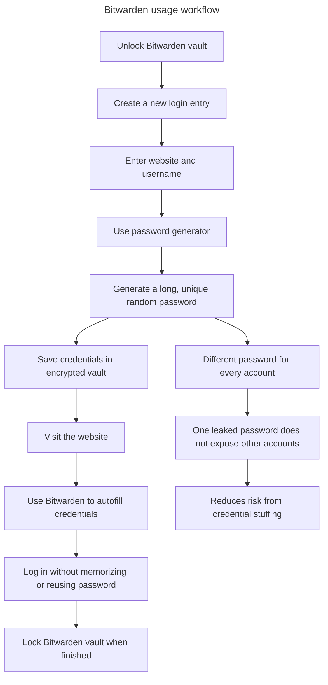

## x) Summary
- Schneier 2015: [Applied Cryptography](https://learning.oreilly.com/library/view/applied-cryptography-protocols/9781119096726/)
  - Chapter 1 - Foundations
    - 1.1 Terminology
      - Sender and Receiver: a sender wants to send a securely message to a receiver.
      - Messages and Encryption: 
        ```mermaid
        ---
        title: Encryption and Decryption
        ---
        flowchart LR
            A[Plaintext] --> B[Encryption]
            B --> C[Ciphertext]
            C --> D[Decryption]
            D --> E[Plaintext]
        ```
        Plaintext is binary data i.e bits, text file, bitmap, audio, video etc. ISO 7498-2 standard uses the terms “encipher” and “decipher, “encrypt” and “decrypt” refer to dead bodies in some cultures.
        - Encryption converts message to ciphertext: E(M) = C
        - Decryption converts ciphertext back to message: D(C) = M
        - Correct encryption or decryption satisfies: D(E(M)) = M
          - C: ciphertext
          - D: decryption function
          - E: encryption function
          - M: message or plaintext (P)
      - Authentication, Integrity, and Nonrepudiation:
        - Authentication: verifies the origin of a message.
        - Integrity: verifies that a message was not modified.
        - Nonrepudiation: prevents a sender from falsely denying sending a message.
      - Algorithms and Keys
        ```mermaid
        ---
        title: Encryption and Decryption with a Key
        ---
        flowchart LR
            K1["Key K"] --> E["Encryption"]
            M["Plaintext M"] --> E
            E --> C["Ciphertext C"]
            C --> D["Decryption"]
            K2["Key K"] --> D
            D --> M2["Plaintext M"]
        ```
        - E<sub>K</sub>(M) = C
        - D<sub>K</sub>(C) = M
        - D<sub>K</sub>(E<sub>K</sub>(M)) = M
        
        Modern cryptography should rely on the secrecy of the key, not secrecy of the algorithm. If an eavesdropper knows the algorithm but the key(s), they can't read the message.
        A cryptosystem is an algorithm, plus all possible plaintexts, ciphertexts, and keys.
     
        ```mermaid
        ---
        title: Encryption and Decryption with Two Different Keys
        ---
        flowchart LR
            K1["Encryption Key K₁"] --> E["Encryption"]
            M["Plaintext M"] --> E
            E --> C["Ciphertext C"]
            C --> D["Decryption"]
            K2["Decryption Key K₂"] --> D
            D --> M2["Plaintext M"]
        ```
        - E<sub>K1</sub>(M) = C
        - D<sub>K2</sub>(C) = M
        - D<sub>K2</sub>(E<sub>K1</sub>(M)) = M

      - Symmetric Algorithms (conventional algorithms, secret-key algorithms, single-key algorithms, or one-key algorithms)
        - Encryption key can be calculated from decryption key and vice versa.
        - In most symmetric algorithms, the encryption key and the decryption key are the same.
        - Sender and receiver agree on a key before they can communicate securely.
        - Divided into 2 categories:
          - stream algorithms/ciphers: operate on the plaintext a single bit (sometimes byte).
          - block algorithms/ciphers: operate on the plaintext in groups of bits which are called blocks.
      - Public-Key Algorithms (asymmetric algorithms)
        - The key used for encryption is different from the key used for decryption.
        - The decryption key can't be calculated from the encryption key.
        - Messages is encrypted with public key and decrypted with private key.
        - Sometimes, messages will be encrypted with private key and decrypted with public key which is used in digital signatures.
        
  - Chapter 2 - Protocol Building Blocks, sections
    - 2.5 Communications Using Public-Key Cryptography
      Public-key cryptography uses 2 different keys: public key - shared openly and used to encrypt a message and private key - kept secret and used to decrypt the message. If Alice wants to send a secure message to Bob: 
      1. Alice obtains Bob's public key.
      2. Alice encrypts the message using Bob's public key.
      3. Alice sends the encrypted message to Bob.
      4. Bob decrypts it using his private key.

      An eavesdropper may know Bob's public key and see the ciphertext, but should not be able to derive the private key or recover the plaintext.
      
      - Hybrid cryptosystems are where public-key cryptography commonly combined with symmetric encryption:
        1. Alice generates a random session key.
        2. Alice encrypts the session key using Bob's public key.
        3. Bob decrypts it with his private key.
        4. Alice and Bob then use the session key for symmetric encryption.

      This combines easier key distribution from public-key cryptography with the speed of symmetric encryption.
      
      - Merkle's Puzzles demonstrated that two parties can establish secure communication without exchanging a secret key beforehand, an important early idea behind public-key cryptography.
        1. Bob creates a large number of puzzles, each containing a random identifier and secret key, and sends them to Alice.
        2. Alice randomly chooses one puzzle and solves it using brute force.
        3. Alice uses the recovered secret key to encrypt her message and sends the puzzle identifier and ciphertext to Bob.
        4. Bob uses the identifier to find the corresponding key and decrypt the message.
        
        An eavesdropper Eve does not know which puzzle Alice selected and therefore has to solve many more puzzles. The idea is to make Eve's computational effort much greater than Alice's or Bob's. if Alice's effort is _n_, Eve's is _n<sup>2</sup>_.

- Karvinen 2023: [PGP - Send Encrypted and Signed Message - gpg](https://terokarvinen.com/2023/pgp-encrypt-sign-verify/)
GNU privacy guard, 'gpg', is a popular way to encrypt and sign.

```ls
# install gpg, 'micro' text editor and 'killall' from psmisc are just helpful extras
$ sudo apt-get update
$ sudo apt-get install gpg micro psmisc
```

First creates a PGP key pair:

```ls
$ gpg --gen-key
```


The fingerprint of keys in the keyring can be checked with:

```ls
   $ gpg --fingerprint
```
The fingerprint provides a way to verify that an imported public key really belongs to the expected person.


Then exports public key:

```ls
   $ gpg --export --armor --output anh.pub
```

The `--armor` option converts the key into printable ASCII representation, making it easy to transfer through methods such as email.

After that created a simulated user, Alice, by creating a folder in our home directory. It was protected so that only the owner (us) can use it.

```ls
  $ cd
  $ mkdir alice/
  $ chmod og-rwx alice/

  # just work inside this alice/ folder, replace 'gpg' with 'gpg --homedir .'
  # so that Alice has her own settings and own keyring, separate from the one we actually use
  $ gpg --homedir . --fingerprint  # '--homedir .' means use current working directory to save gpg configuration files. Listing the fingerprints of all keys prints nothing, because Alice does not yet have any keys
  gpg: keybox '/home/tna/alice/pubring.kbx' created
  gpg: /home/tna/alice/trustdb.gpg: trustdb created

  $ gpg --homedir . --gen-key # create Alice's own keypair

  # let Alice import my public key
  $ cd
  $ cp -v anh.pub alice/
  'anh.pub' -> 'alice/anh.pub'
  $ cd alice/
  $ gpg --homedir . --import anh.pub
```

Public keys do not need to be transferred secretly. However, Alice must verify my key fingerprint through a trusted method to make sure that an attacker has not substituted another key.

After verification, Alice can sign my key to indicate that she trusts it:

```ls
    $ gpg --homedir . --sign-key "fingerprint"

    # trust has been established
    $ gpg --homedir . --fingerprint
    uid            [ultimate] Alice <alice@example.com.invalid>
    uid           [  full  ] Anh To DEMO KEY <tna@example.com.invalid>

    # we need Alices public key to know it's her
    # exporting, importing, verifying and trusting the key are same as before, swap the roles only
    $ gpg --homedir . --export --armor --output alice.pub
    $ cp -v alice/alice.pub .
    'alice/alice.pub' -> './alice.pub'

    # key is sent over untrusted channel
    $ cd 
    $ cp -v alice/alice.pub .

    # import Alice the key and verify Alice's public key
    $ gpg --import alice.pub
    $ gpg --sign-key "EB13 B092 6F39 4346 7D52  C3BB A8D1 4A7B 7F62 A28E"
    $ gpg --fingerprint
    uid           [  full  ] Alice <alice@example.com.invalid>
```

Once trust has been established, Alice can encrypt a message to send and digitally sign it:

```ls
    $ cd ~/alice/
    $ micro msg.txt # write something then saves Ctrl-S and quits Ctrl-Q.
    $ gpg --homedir . --encrypt \
        --recipient tna@example.com.invalid \
        --sign \
        --output encrypted.pgp \
        --armor msg.txt
```

- `--encrypt`: Encrypt the message.
- `--recipient`: Select the recipient's public key.
- `--sign`: Sign the message using Alice's private key.
- `--armor`: Produce an ASCII-armored PGP message.
- `--output`: Specify the encrypted output file.

The resulting file begins with:

    -----BEGIN PGP MESSAGE-----

The content can then be transferred over an untrusted network because someone intercepting it cannot read the original plaintext without my private key.

Decrypt the received message with:

```ls
$ gpg --decrypt encrypted.pgp
```
GPG uses the recevier's private key to decrypt the message. At the same time, Alice's public key is used to verify her digital signature.

A successful verification produces output such as:

    Good signature from "Alice ..."


## a) Pubkey today
An example is Git over SSH, I also have my own PGP key and if I use an SSH remote to pull or push code. In that case, a private key stored on my computer can be used to authenticate me, while the corresponding public key is known by the remote service.

## b) Encrypt and decrypt a message
I consider GPG a secure tool for encrypting and signing messages when the keys are properly managed.
- The sender uses the recipient's public key when encrypting, while only the recipient possesses the corresponding private key needed for decryption. GPG also uses a symmetric session key for efficient encryption of the actual message.
- If authentication is required, the sender can sign the message with their own private key and the recipient can verify the signature using the sender's public key. This provides confidentiality, integrity and authenticity.
- However, the cryptography cannot solve the trust problem automatically. If I accept a public key without verifying its fingerprint, I could encrypt information for an attacker's key instead. Protecting private keys and reliably verifying public keys are therefore essential parts of GPG's security.

## c) Password management
Demonstrate use of Bitwarden password manager:




People who do not use a password manager may be more likely to reuse passwords or create passwords that are easy to remember and therefore easier to guess. One important attack that takes advantage of this is credential stuffing. Attackers obtain username and password combinations from a breached service and automatically try the same credentials on other services

## d) Voluntary: Details of PGP
Send an encrypted and signed message using PGP, then verify and decrypt it using previously Alice folder to simulate user.
```ls
# The same process is repeated in the opposite direction like the instructions from Karvinen 2023: [PGP - Send Encrypted and Signed Message - gpg](https://terokarvinen.com/2023/pgp-encrypt-sign-verify/)
tna@debian:~/alice$ cd
tna@debian:~$ cp -v alice/anh.pub .
'alice/anh.pub' -> './anh.pub'
tna@debian:~$ gpg --import anh.pub 
gpg: key 9997CB85DA699699: "Anh To DEMO KEY <tna@example.com.invalid>" not changed
gpg: Total number processed: 1
gpg:              unchanged: 1
tna@debian:~$ gpg --fingerprint 
/home/tna/.gnupg/pubring.kbx
----------------------------
pub   ed25519 2026-11-23 [SC] [expires: 2029-11-22]
      D61E 6982 87C1 E865 6B26  B32E 9997 CB85 DA69 9699
uid           [ultimate] Anh To DEMO KEY <tna@example.com.invalid>
sub   cv25519 2026-11-23 [E] [expires: 2029-11-22]

pub   ed25519 2026-11-23 [SC] [expires: 2029-11-22]
      EB13 B092 6F39 4346 7D52  C3BB A8D1 4A7B 7F62 A28E
uid           [  full  ] Alice <alice@example.com.invalid>
sub   cv25519 2026-11-23 [E] [expires: 2029-11-22]
tna@debian:~$ gpg --encrypt --recipient alice@example.com.invalid --sign --output encrypted2.pgp --armor message.txt 
tna@debian:~$ head -4 encrypted2.pgp 
-----BEGIN PGP MESSAGE-----

hF4D6OTbKnNPnyMSAQdAxXaKpmoXO1SZhOGQJnrINImlj6T1gUclzD1PAr2iNR4w
AqOy3Hld7Oj4RbZ06WRpjSQsuKVINgtPL/XQyPX+NclyxOz8fcnACuIkCogGmE3p

# simulate the message transfer by copying the file
tna@debian:~$ cp -v encrypted2.pgp alice/
'encrypted2.pgp' -> 'alice/encrypted2.pgp'

# Alice received my message and decrypted it
tna@debian:~$ cd alice/
tna@debian:~/alice$ gpg --homedir . --decrypt encrypted2.pgp
gpg: encrypted with cv25519 key, ID E8E4DB2A734F9F23, created 2026-11-23
      "Alice <alice@example.com.invalid>"
Hi Alice,

This is my secret message. I'm so happy we have PGP to protect our communications! 

The right to private communication is important in a free society. 

-- Anh
gpg: Signature made Mon 23 Nov 2026 10:17:58 PM EET
gpg:                using EDDSA key D61E698287C1E8656B26B32E9997CB85DA699699
gpg: Good signature from "Anh To DEMO KEY <tna@example.com.invalid>" [full]

```
## e) Voluntary
[Cryptopals: Challenge Set 1](https://www.cryptopals.com/sets/1)
1. Convert hex to base64 (feel free to use a library for base64)
2. Fixed XOR
3. Single-byte XOR cipher
4. [Detect single-character XOR](https://www.cryptopals.com/sets/1/challenges/4)
